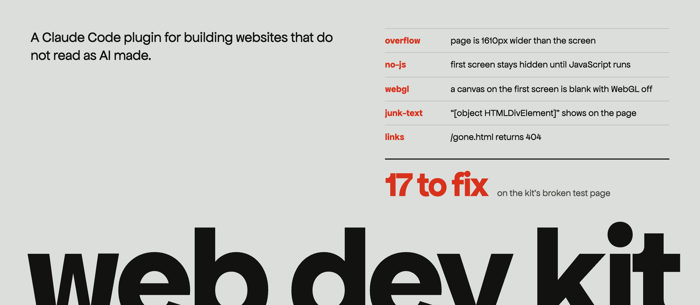

<p align="center">
  
</p>

<p align="center">
  <a href="https://github.com/levimackay/web-dev-kit/actions/workflows/check.yml"></a>
  <a href="https://github.com/levimackay/web-dev-kit/releases"></a>
  <a href="#install"></a>
</p>

Every site Claude builds starts out looking like every other site Claude builds. Same fonts, same cream ground, same three cards, same fade up on scroll. This kit is everything I use to stop that: the best public skills for web work, pinned and installed in one go, the rules I used to apply by hand on every build, and two tools that check the result before anyone sees it.

## Install

In Claude Code:

```
/plugin install web-dev-kit --marketplace levimackay/web-dev-kit
```

Then ask Claude to **"set up the web dev kit"**. It lists every plugin and skill it is about to add and installs them once you say yes. Restart Claude Code afterwards.

<details>
<summary>Without the plugin system</summary>

Download `web-dev-kit-<version>.zip` from [Releases](https://github.com/levimackay/web-dev-kit/releases), unzip it into `~/.claude/skills/`, then run:

```bash
bash ~/.claude/skills/web-dev-kit/install.sh
```

| Option | Effect |
| --- | --- |
| `--extras` | Also installs 3D (three.js), React motion, scroll-craft, diagrams, video tools (Remotion, HyperFrames, brag), GetLayers and 67 visual style skills |
| `--dry-run` | Prints the list and stops |
| `--yes` | Installs without asking |

It needs `claude`, Node 20 or newer and `git`. Rerunning it is safe.

</details>

Two steps stay manual: the Anthropic `design` plugin comes from claude.ai under Customize, then Plugins, and GetLayers (extras only) needs its account connected through `/mcp`.

## What you get

**The tools.** 12 plugins and 36 skills from Anthropic, Google Chrome, Vercel, GreenSock, Addy Osmani, Emil Kowalski, Jakub Krehel and more, each skill pinned to a fixed commit. One skill routes Claude to the right one for each job.

**The rules.** Nine files of what the skills do not cover, taken from real builds and their fix rounds:

| File | What it stops |
| --- | --- |
| [`workflow.md`](skills/web-dev-kit/rules/workflow.md) | Building before there are references, rendered directions and a spec |
| [`look.md`](skills/web-dev-kit/rules/look.md) | The visual signature that reads as machine made |
| [`type.md`](skills/web-dev-kit/rules/type.md) | Default fonts, unlicensed fonts, fonts that shift the layout when they load |
| [`imagery.md`](skills/web-dev-kit/rules/imagery.md) | Fake people and products, images with no licence trail |
| [`copy.md`](skills/web-dev-kit/rules/copy.md) | AI punctuation, invented facts, copy that does not match the product |
| [`build.md`](skills/web-dev-kit/rules/build.md) | Code a senior engineer would know a model wrote |
| [`motion.md`](skills/web-dev-kit/rules/motion.md) | Jolty scroll, blurry zooms, content that waits for JavaScript |
| [`responsive.md`](skills/web-dev-kit/rules/responsive.md) | Sideways scroll, collisions between breakpoints, tables on phones |
| [`gotchas.md`](skills/web-dev-kit/rules/gotchas.md) | Things that build fine and still break |

**The checks.** Two scripts that look at the real page in a real browser.

## The page check

`check.sh` opens a running page or a built folder at 1440, 768 and 390 wide, scrolls all of it, loads it again with JavaScript off, with reduced motion and with WebGL off, then reports what a reviewer would catch. It exits 1 when something has to be fixed.

```bash
bash check.sh http://localhost:5173/ --src .
```

These are real lines from its output on the deliberately broken page in its own tests:

```text
FAIL  overflow        390       page is 1610px wider than the screen. Widest: main > canvas#scene, main > div.wide
FAIL  no-js                     first screen stays hidden until JavaScript runs: "Bad page"
FAIL  webgl                     a canvas on the first screen is blank with WebGL off. Add a fallback.
FAIL  junk-text                 "hip well; trust us! [object HTMLDivElement] Jump Gone Badge" shows on the page
FAIL  dashes                    em or en dash: "ably on a phone. We ship fast — and we ship well; trust us! ["
FAIL  links                     /gone.html returns 404
FAIL  a11y            1440 390  image-alt: Images must have alternative text (1)
WARN  fonts                     Inter reads as a default pick. Take type from the reference instead.
WARN  gsap-centering            .badge is centred with CSS translate and animated by GSAP. Centre it with xPercent and yPercent instead.
WARN  scroll-clocks             Lenis has its own duration ease and the scrubs are short. Two clocks fight on fast scrolls. Use the Lenis defaults with scrub: 1.
WARN  comment                   index.html: "Step 1: Initialize the hero"

17 to fix, 12 to look at
```

<details>
<summary>Everything it checks</summary>

| Fails on | Warns on |
| --- | --- |
| Console errors and failed requests | Text under 16px |
| Sideways overflow, naming the element causing it | Fonts in the 150 most used on Google Fonts, and the usual default picks |
| Broken images | Upscaled images that will look soft |
| `[object ...]` or `{{ template }}` text on the page | Semicolons, mid sentence colons, exclamation marks, emoji |
| Em and en dashes in the copy | Content hidden under reduced motion |
| Links and anchors that go nowhere | Missing title, description, lang or a single h1 |
| Serious and critical accessibility failures (axe) | No privacy or terms link |
| The first screen hidden until JavaScript runs | Comments like "Step 1" or "Initialize", console.log, TODO |
| A blank canvas or a crash with WebGL off | GSAP animating an element centred with CSS translate |
| Attribution strings and generator tags | Lenis and short scrubs fighting each other |
| Build folders, `.env` files and tool output missing from `.gitignore` | `overflow-x: hidden` on body hiding a wide element |

</details>

## The font check

`fonts.sh` shows which face a reference site really renders, which can differ from its CSS, and what each font file says about its licence. Pick type from a site you admire without guessing or shipping something you cannot use.

```text
$ bash fonts.sh https://velvetyne.alwaysdata.net/

h2      renders Velvelyne Book  (css: vtf-centerline, sans-serif)
p       renders Velvelyne Book  (css: vtf-centerline, sans-serif)

Velvelyne  Velvelyne-Book.woff2
  foundry   Velvetyne
  designer  Manon Van der Borght et Mariel Nils
  vendor    velvetyne.fr
  license   SIL OFL
```

## How a site gets built with it

1. A facts file, so nothing on the page is invented.
2. Three to five real reference sites, with their tokens pulled by `dembrandt` and their fonts by `fonts.sh`.
3. One sentence that names the idea the page commits to.
4. An inventory of real photos and screenshots before any layout.
5. Three directions, rendered, and the person picks one by number.
6. A spec with exact copy and tokens, linted with Google's `design.md`.
7. A build from the spec only.
8. Renders at three widths plus `check.sh`.
9. Numbered fix rounds with measured defects, three at least.
10. A cold critic who sees only the screenshots before anyone else does.

The full loop is in [`workflow.md`](skills/web-dev-kit/rules/workflow.md).

## What it installs

<details>
<summary>Core: 12 plugins and 36 skills</summary>

| From | What | For |
| --- | --- | --- |
| [Anthropic](https://github.com/anthropics/claude-plugins-official) | frontend-design, vercel, supabase, chrome-devtools-mcp, code-review, pr-review-toolkit, feature-dev, code-simplifier, claude-security | Design direction, deploys, data, Chrome debugging, review, security |
| [pbakaus/impeccable](https://github.com/pbakaus/impeccable) | impeccable | Critique, polish and redesign |
| [greensock/gsap-skills](https://github.com/greensock/gsap-skills) | gsap-skills | GSAP and ScrollTrigger |
| [addyosmani/web-quality-skills](https://github.com/addyosmani/web-quality-skills) | web-quality-skills | Performance, accessibility and SEO audits |
| [vercel-labs/agent-skills](https://github.com/vercel-labs/agent-skills) | web-design-guidelines, vercel-composition-patterns, vercel-react-view-transitions | Interface guidelines, React structure, page transitions |
| [jakubkrehel/skills](https://github.com/jakubkrehel/skills) | better-typography, better-colors, better-layout, better-ui, better-accessibility, better-writing, interface-review | Craft passes with exact values |
| [ibelick/ui-skills](https://github.com/ibelick/ui-skills) | baseline-ui, fixing-accessibility, fixing-motion-performance, fixing-metadata | Fast fixes for generic UI |
| [Nutlope/hallmark](https://github.com/Nutlope/hallmark) | hallmark | Anti slop gates for new sites |
| [leonxlnx/taste-skill](https://github.com/leonxlnx/taste-skill) | design-taste-frontend | Art direction |
| [nextlevelbuilder/ui-ux-pro-max-skill](https://github.com/nextlevelbuilder/ui-ux-pro-max-skill) | ui-ux-pro-max | Styles, palettes and UX rules |
| [meodai/skill.color-expert](https://github.com/meodai/skill.color-expert) | color-expert | Colour science, OKLCH, contrast |
| [GoogleChrome/modern-web-guidance](https://github.com/GoogleChrome/modern-web-guidance) | modern-web-guidance | Current web platform features |
| [blader/humanizer](https://github.com/blader/humanizer) | humanizer | Copy that reads as AI written |
| [coreyhaines31/marketingskills](https://github.com/coreyhaines31/marketingskills) | copywriting, cro | Landing page copy and conversion |
| [emilkowalski/skills](https://github.com/emilkowalski/skills) | review-animations, animation-performance, break-ui, mobile-native | Motion craft, worst case data, native feel on phones |
| [nucliweb/webperf-snippets](https://github.com/nucliweb/webperf-snippets) | six webperf skills | Core Web Vitals in the browser |
| [AgriciDaniel/claude-seo](https://github.com/AgriciDaniel/claude-seo) | seo-local, seo-schema, seo-technical | SEO |
| [microsoft/playwright-cli](https://github.com/microsoft/playwright-cli) | playwright-cli | Driving a browser |

</details>

<details>
<summary>Extras: 2 plugins and 101 skills</summary>

| From | What |
| --- | --- |
| [CloudAI-X/threejs-skills](https://github.com/CloudAI-X/threejs-skills) | 13 three.js skills |
| [affaan-m/ECC](https://github.com/affaan-m/ECC) | motion-foundations, motion-patterns, motion-advanced (Motion for React) |
| [nateherkai/scroll-craft](https://github.com/nateherkai/scroll-craft) | Scroll driven brand landing pages |
| [cathrynlavery/diagram-design](https://github.com/cathrynlavery/diagram-design) | Diagrams styled with the site's tokens |
| [remotion-dev/skills](https://github.com/remotion-dev/skills) | 12 Remotion video skills |
| [heygen-com/hyperframes](https://github.com/heygen-com/hyperframes) | HTML video and motion graphics |
| [latent-spaces/brag](https://github.com/latent-spaces/brag) | A launch video from your site |
| [textura-agency/getlayers-plugin](https://github.com/textura-agency/getlayers-plugin) | GetLayers sites, 3D and motion |
| [bergside/awesome-design-skills](https://github.com/bergside/awesome-design-skills) | 67 named visual styles |

</details>

The rules also point to tools that run with `npx` when needed, pinned to a version: [dembrandt](https://github.com/dembrandt/dembrandt), [Google's design.md](https://github.com/google-labs-code/design.md), [fontaine](https://github.com/unjs/fontaine), [Capsize](https://github.com/seek-oss/capsize), [subfont](https://github.com/Munter/subfont) and [Unlighthouse](https://github.com/harlan-zw/unlighthouse). And to reference collections: [design-bites](https://github.com/educlopez/design-bites), [awesome-design-md](https://github.com/VoltAgent/awesome-design-md) and [official-design-md](https://github.com/VoltAgent/official-design-md).

Each tool installs from its own repo and keeps its own licence. Impeccable and brag are pinned to release tags. The other plugin marketplaces publish no tags, so they follow their latest version.

## Updating the pins

```bash
bash skills/web-dev-kit/scripts/pin.sh
```

Moves every commit pin to the current head of its repo, so the changes can be reviewed in one diff.
